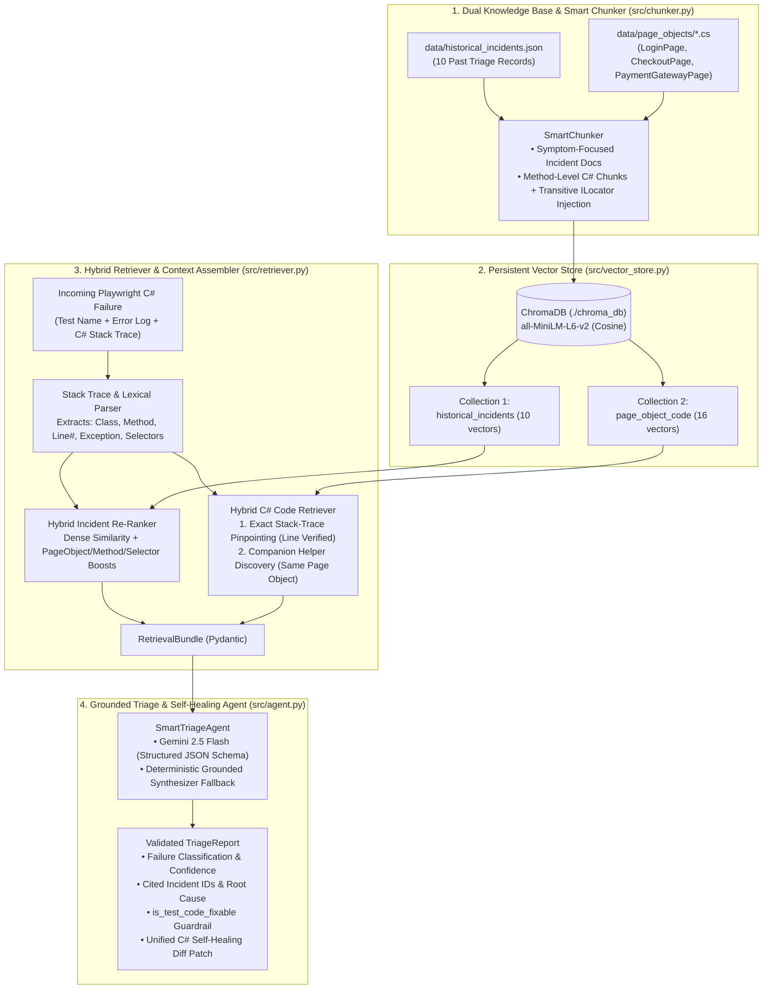

# Smart Triage RAG — AI-Powered Test Failure Triage & Self-Healing Agent

[](https://www.python.org/)
[-2EAD33?logo=playwright&logoColor=white)](https://playwright.dev/dotnet/)
[](https://www.trychroma.com/)
[](https://ai.google.dev/)
[](https://docs.pydantic.dev/)

**Smart Triage RAG** is a portfolio-grade AI Test Failure Triage & Self-Healing Agent designed for enterprise **Playwright C# (.NET)** E2E automation suites.

Instead of feeding raw stack traces to an ungrounded LLM (which leads to hallucinated locators and broken patches) or relying on naive character-split embeddings, this system combines **AST/Regex Method-Level C# Smart Chunking**, **Dual-Collection ChromaDB Vector Indexing**, **Hybrid Lexical + Stack-Trace Metadata Re-Ranking**, and **Schema-Constrained Self-Healing Patch Generation**.

---

## System Architecture



---

## Key Architectural & Engineering Decisions

### 1. Why Naive Chunking Fails on Page Object Code (And How `SmartChunker` Solves It)
Standard fixed-size token chunkers slice C# classes arbitrarily—separating private `ILocator` declarations at the top of a Page Object from the action methods (`LoginWithCredentialsAsync`, `ApplyPromoCodeAsync`) 40 lines below that use them.
* **Our Solution ([src/chunker.py](src/chunker.py))**:
  * **Pass 1**: Parses namespace, class name, and all class-level `ILocator` and `IFrameLocator` expression-bodied properties, resolving **transitive locator dependencies** (e.g., `CardNumberInput` inside `StripePaymentFrame`).
  * **Pass 2**: Splits the C# class along exact method boundaries using brace-depth tracking, numbers every source line (`L44: ...`), and **prepends the relevant class-level locator declarations** directly into each method chunk's header. Every retrieved method chunk is 100% self-contained.

### 2. Why Pure Dense Vector Search Fails on Stack Traces (And How `HybridTriageRetriever` Solves It)
Dense embedding models (`all-MiniLM-L6-v2`) compress text into semantic concepts, often scoring two different `PlaywrightException` stack traces similarly even when they occur in different methods or involve different `data-testid` attributes. Furthermore, dense cosine similarity between an exception log and raw C# code is naturally low (~`0.45`).
* **Our Solution ([src/retriever.py](src/retriever.py))**:
  * **Deterministic Signal Extraction**: Extracts `target_class`, `target_method`, `failing_line`, `exception_type`, HTTP status codes (`502`), and CSS/`data-testid` tokens from the raw stack trace.
  * **Hybrid Incident Scoring**: Combines dense cosine similarity with explicit metadata/lexical boosts (`+0.08` Page Object match, `+0.10` Method match, `+0.05` Exception match, up to `+0.12` Selector overlap, up to `+0.10` Domain keyword overlap).
  * **Exact Code Pinpointing + Line Verification**: Uses ChromaDB `where={"class_name": target_class}` filtering and verifies `start_line <= failing_line <= end_line` (`EXACT_STACK_TRACE_PINPOINT`, `+0.35` structural boost).

### 3. Cross-Method Companion Retrieval for Race Conditions
Sometimes the line that crashes in a stack trace is the **victim**, not the root cause.
* **Example (Scenario 2)**: `LoginPage.LoginWithCredentialsAsync` fails at line `L48` (`SignInButton.ClickAsync`) because a late-loading OneTrust cookie banner (`#onetrust-consent-sdk`) obscures the button.
* Because `HybridTriageRetriever` queries companion methods in `LoginPage` and boosts chunks whose injected locators match failure keywords (`onetrust`), it automatically surfaces:
  1. **Rank #1**: `LoginPage.LoginWithCredentialsAsync` (`L44-L49`, `EXACT_STACK_TRACE_PINPOINT`, Score `0.8719`)
  2. **Rank #2**: `LoginPage.DismissCookieBannerIfPresentAsync` (`L36-L42`, `SEMANTIC_CLASS_COMPANION`, Score `0.5873`, which holds `L20: CookieConsentAcceptBtn => _page.Locator("#onetrust-accept-btn-handler")`).
* This gives the LLM the exact helper method it needs to replace a racy `IsVisibleAsync()` check with Playwright's `AddLocatorHandlerAsync()`.

### 4. False-Positive Self-Healing Guardrail (`is_test_code_fixable`)
Not every E2E test failure should trigger a pull request against test code. When `CheckoutPage.ProceedToPaymentStepAsync` fails with `HTTP 502: Bad Gateway` on `/api/v2/inventory/reserve` (Scenario 3), the agent classifies it as `"Backend API Timeout"`, sets `is_test_code_fixable = False`, suppresses C# patch generation, and outputs Kubernetes/API Gateway remediation steps.

---

## Project Structure

```text
smart-triage-rag/
├── data/
│   ├── historical_incidents.json       # Knowledge Base 1: 10 detailed Playwright C# failure incidents
│   └── page_objects/                   # Knowledge Base 2: C# Playwright Page Object classes
│       ├── CheckoutPage.cs
│       ├── LoginPage.cs
│       └── PaymentGatewayPage.cs
├── src/
│   ├── __init__.py
│   ├── chunker.py                      # Context-aware incident & C# method smart chunker
│   ├── vector_store.py                 # ChromaDB persistent dual-collection manager
│   ├── ingest.py                       # CLI ingestion & vector sanity-check script
│   ├── retriever.py                    # Hybrid dense + lexical + stack-trace retriever
│   ├── test_retriever.py               # CLI benchmark comparing Dense vs. Hybrid retrieval scores
│   ├── agent.py                        # Gemini 2.5 Flash + Offline Grounded Synthesizer Agent
│   └── main.py                         # End-to-End Rich CLI Triage & Self-Healing dashboard
├── requirements.txt
├── .gitignore
└── README.md
```

---

## Quickstart & Usage

### 1. Install Dependencies
```bash
pip install -r requirements.txt
```

### 2. (Optional) Configure Gemini API Key
Create a `.env` file in the project root:
```ini
GEMINI_API_KEY=your_google_ai_studio_key_here
```
> **Zero-Config Offline Execution**: If `GEMINI_API_KEY` is not set (or `--offline` is passed), `SmartTriageAgent` automatically runs its **Deterministic Grounded RAG Synthesizer**, producing complete `TriageReport` outputs and unified C# diffs directly from ChromaDB retrieval results.

### 3. Ingest Knowledge Base & Run Vector Sanity Check
```bash
python -m src.ingest
```

### 4. Benchmark Dense vs. Hybrid Retrieval Scores
```bash
python -m src.test_retriever
```

### 5. Run the End-to-End AI Triage & Self-Healing Pipeline
Run all 3 end-to-end scenarios (UI Locator Strict Mode Violation, Cross-Method Cookie Overlay Race Condition, and Backend HTTP 502 Outage):
```bash
python -m src.main --all
```
Or run an individual scenario or custom failure log:
```bash
python -m src.main --scenario 1
python -m src.main --scenario 2
python -m src.main --scenario 3
```

---

## Sample End-to-End Output (`python -m src.main --all`)

### Scenario 1: UI Locator Ambiguity -> Automated C# Strict-Mode Patch
```diff
--- a/data/page_objects/CheckoutPage.cs
+++ b/data/page_objects/CheckoutPage.cs
@@ -18,3 +18,3 @@ namespace SmartCommerce.E2E.Pages
         private ILocator PromoCodeInput => _page.GetByPlaceholder("Enter promo or gift code");
-        private ILocator ApplyPromoButton => _page.GetByRole(AriaRole.Button, new() { Name = "Apply" });
+        private ILocator ApplyPromoButton => _page.GetByRole(AriaRole.Button, new() { Name = "Apply", Exact = true });
         private ILocator PromoDiscountRow => _page.GetByTestId("order-summary-discount-amount");
```

### Scenario 2: Cross-Method Cookie Overlay Race Condition -> `AddLocatorHandlerAsync` Patch
```diff
--- a/data/page_objects/LoginPage.cs
+++ b/data/page_objects/LoginPage.cs
@@ -36,7 +36,7 @@ namespace SmartCommerce.E2E.Pages
         public async Task DismissCookieBannerIfPresentAsync()
         {
-            if (await CookieConsentAcceptBtn.IsVisibleAsync())
-            {
-                await CookieConsentAcceptBtn.ClickAsync();
-            }
+            await _page.AddLocatorHandlerAsync(
+                CookieConsentAcceptBtn,
+                async bannerBtn => await bannerBtn.ClickAsync());
         }
```

### Scenario 3: Backend HTTP 502 Outage -> Guardrail Blocks Test Patching
* **Classification**: `Backend API Timeout` (`Confidence: 0.96`, Cited: `INC-2026-004`)
* **Self-Heal Eligible (`is_test_code_fixable`)**: `False` — Prevents mutating C# test code when the fault lies in `inventory-reservation-service` pods restarting in QA.
